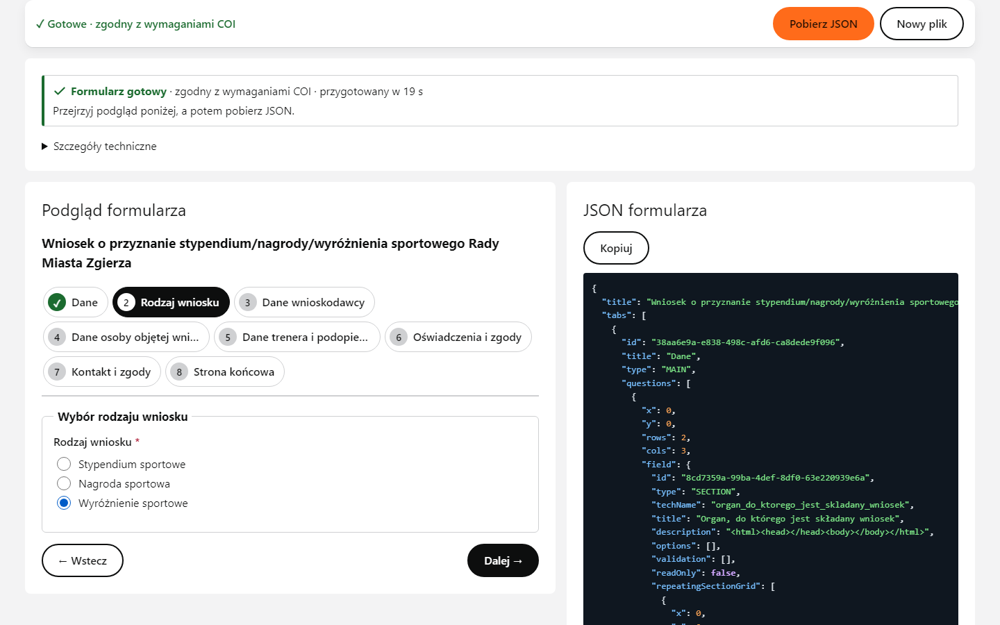
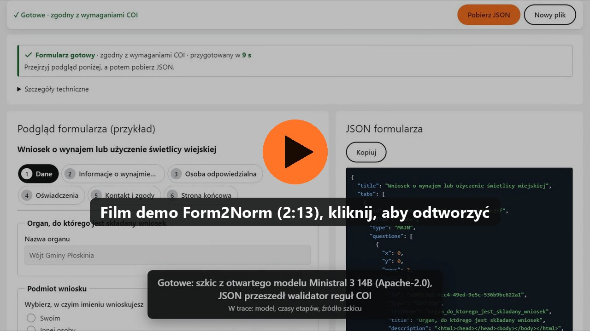
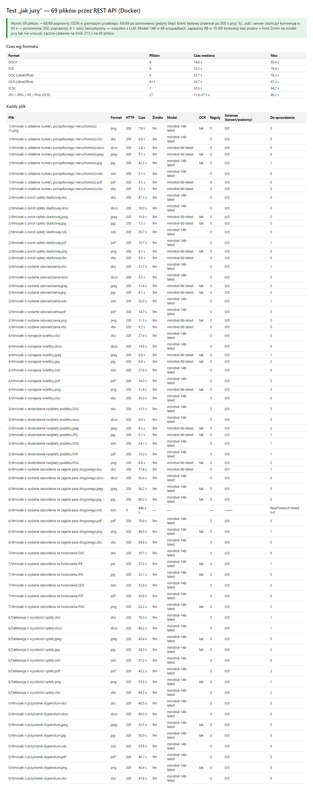
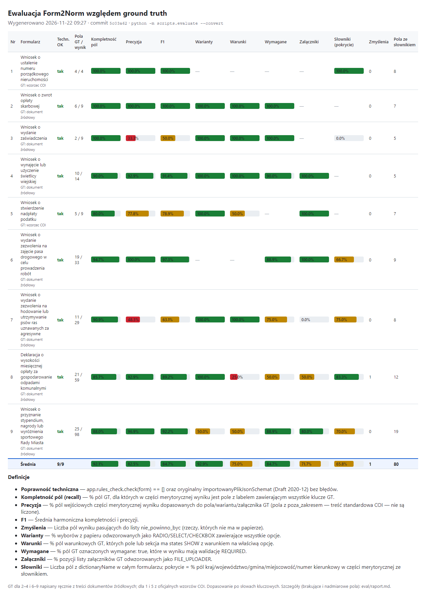

# Form2Norm — papierowy wniosek → e-formularz COI w kilkadziesiąt sekund

**Form2Norm** zamienia papierowy formularz urzędowy (PDF, Word, Excel, ODS, skan JPG/PNG) w **JSON e-formularza zgodny ze standardem COI** — gotowy do importu w generatorze formularzy mObywatela. Urzędnik wrzuca plik, sprawdza podgląd i pobiera JSON. Wyniki w postaci JSON-ów dla poszczególnych wniosków znajdują się w katalogu **/wyniki**.

| | |
|---|---|
| **69/69** plików (wszystkie formaty z danych COI) → poprawny JSON | walidator reguł COI + **oryginalny** `importowanyPlikJsonSchemat` na każdym poziomie ([raport](#4-wyniki-i-metryki)) |
| **92% kompletności pól, F1 85%** względem ręcznego ground truth | [metryki + zrzut raportu](#42-jakość-treści--porównanie-z-ground-truth) |
| **mediana 28 s** na dokument (DOCX/PDF ~15 s, skan z OCR ~30 s) | na zwykłym **CPU, bez GPU** |
| **Ministral 3 14B** (otwarte wagi, Apache-2.0) | wybrany na podstawie [benchmarku](#6-model-ai--który-i-dlaczego) |
| **OWASP Top 10 + OWASP LLM Top 10** opisane z dowodami w testach | [docs/OWASP.md](docs/OWASP.md) |



### Film demo (2:13)

[](de%28mo%29COI.mp4)

[**`de(mo)COI.mp4`**](de%28mo%29COI.mp4): nagranie prawdziwego działania aplikacji. Obie konwersje na filmie to prawdziwe wywołania modelu Ministral 3 14B; czekanie na AI jest przyspieszone ×6 i oznaczone na ekranie. Na końcu: zmierzone wyniki i lista użytych modeli i bibliotek.

---

## Spis treści

1. [Uruchomienie w 3 krokach](#1-uruchomienie-w-3-krokach)
2. [Jak się tego używa](#2-jak-się-tego-używa)
3. [Jak to działa](#3-jak-to-działa)
4. [Wyniki i metryki](#4-wyniki-i-metryki)
5. [Dlaczego taka architektura](#5-dlaczego-taka-architektura)
6. [Model AI — który i dlaczego](#6-model-ai--który-i-dlaczego)
7. [Bezpieczeństwo, OWASP, AI Act, RODO](#7-bezpieczeństwo-owasp-ai-act-rodo)
8. [Konfiguracja](#8-konfiguracja)
9. [REST API w 30 sekund](#9-rest-api-w-30-sekund)
10. [Dla dewelopera ](#10-dla-dewelopera)
11. [Znane ograniczenia](#11-znane-ograniczenia)

---

## 1. Uruchomienie w 3 krokach

Potrzebny jest tylko **Docker** (Docker Desktop na Windows/macOS).

**Krok 1. Skopiuj wzór konfiguracji:** `cp .env.example .env` (Windows: `copy .env.example .env`).

**Krok 2. W pliku `.env` uzupełnij trzy linie** (reszta ma gotowe wartości):

```
LLM_API_KEY=<klucz Mistral API; jury dostaje go od nas osobno>
AUTH_PASSWORD=<dowolne hasło do logowania w aplikacji>
JWT_SECRET=<dowolny długi losowy tekst, np. wynik: openssl rand -hex 32>
```

**Krok 3. Uruchom** i otwórz http://localhost:8000 (login `admin`, hasło z `AUTH_PASSWORD`):

```bash
docker compose up --build     # pierwszy raz ok. 3 min (budowa obrazu), potem kilka sekund
```

**Windows:** zamiast kroków 1–3 możesz uruchomić **`start.bat`**. Skrypt utworzy `.env` i otworzy go do uzupełnienia, a po ponownym uruchomieniu zbuduje obraz, poczeka, aż aplikacja wstanie, i otworzy przeglądarkę. Zatrzymanie: `start.bat stop`.

Klonując na Windowsie, użyj `git clone -c core.longpaths=true …`. Materiały COI w `data/` mają długie nazwy plików i bez tej opcji klonowanie do głęboko zagnieżdżonego katalogu się nie uda. Do samego uruchomienia folder `data/` nie jest potrzebny.

Bez `LLM_API_KEY` aplikacja działa, ale robi tylko prosty szkic bez AI. Bez `AUTH_PASSWORD` i `JWT_SECRET` logowanie pokaże czytelny błąd, bo nie wydajemy tokenów z pustym sekretem.

Swagger API: http://localhost:8000/docs · uruchomienie bez Dockera i budowa obrazu: [docs/URUCHOMIENIE.md](docs/URUCHOMIENIE.md)

## 2. Jak się tego używa

1. **Wrzuć plik** (przeciągnij albo kliknij) → **Konwertuj**.
2. **Sprawdź** podgląd: formularz wygląda jak w mObywatelu, warunki działają (wybierz wariant wniosku — pojawiają się tylko pola, które go dotyczą). Karty pod spodem mówią, **co zmieniliśmy względem oryginału**, co **sprawdzić**, gdzie poprawić **prosty język** i jakie **słowniki** warto dodać.
3. **Pobierz JSON** i zaimportuj go w generatorze COI.

## 3. Jak to działa

```
 plik ─► [1] walidacja pliku ─► [2] odczyt tekstu ─► [3] AI: szkic treści ─► [4] builder COI ─► [5] walidator ─► JSON
          typ z treści,           PDF/DOCX/XLSX,       tylko część            strony standardowe,   JSON Schema COI
          rozmiar, makra,         DOC/ODS (LibreOffice), merytoryczna          słowniki, warunki,    + reguły techniczne
          zip-bomba               skan → OCR           (JSON Schema)          UUID, układ           (inaczej: szkic bez AI)
```

- **AI robi tylko to, czego nie da się zrobić regułami:** czyta treść dokumentu i opisuje pola merytoryczne (etykiety, typy, warianty, wymagalność).
- **Wszystko, co musi być zawsze poprawne, robi kod:** strony „Dane” i „Kontakt i zgody” z oficjalnych wzorców COI, dane z rejestrów (PESEL, profil zaufany), słowniki (TERYT, Kraje, Numery kierunkowe), warunki JSONata, identyfikatory, układ, strona końcowa.
- **Każdy wynik przechodzi walidator** przed wysłaniem. Gdy AI zawiedzie (brak klucza, limit, zły wynik), formularz powstaje z szkicu heurystycznego — API nigdy nie zwraca 500 z powodu AI.

Kod: `app/validation.py` → `hackcore/ingest/` → `app/form_builder/draft_llm.py` → `app/form_builder/builder.py` → `app/rules_check.py`.

## 4. Wyniki i metryki

### 4.1 Poprawność techniczna — test „jak jury” (69 plików)

Wszystkie pliki z danych COI (`data/1–9`, 9 formatów) wysłane **na żywo przez REST API** do kontenera Docker, każdy JSON sprawdzony walidatorem reguł i **oryginalnym** schematem COI:

| Wynik | Wartość |
|---|---|
| Poprawny JSON (reguły COI + oryginalny schemat na każdym poziomie) | **69 / 69** (68 w 1. przebiegu, 1 timeout klienta testowego — serwer skończył w 39 s) |
| Szkic z AI (bez awaryjnej heurystyki) | **68 / 68** odpowiedzi |
| Czas: mediana / max | **28 s / 80 s** (DOCX 15 s, PDF 15 s, DOC/ODS/XLSX ~30 s, skany 12–37 s) |

Pełny raport z tabelą dla każdego pliku: [docs/TEST_JURY.md](docs/TEST_JURY.md). Odtworzenie: `python -m scripts.jury_test --url http://localhost:8000`.

<details><summary>Zrzut raportu (dowód) — 69 plików, czas, model, reguły i schemat dla każdego</summary>



</details>

### 4.2 Jakość treści — porównanie z ground truth

Sama poprawność techniczna to za mało: liczy się, czy w formularzu są **właściwe pola**. Dlatego zrobiliśmy **ground truth** dla wszystkich 9 formularzy (`eval/ground_truth/*.yaml`). Dla 1 i 5 jest to oficjalny wzorzec COI, a dla pozostałych lista pól spisana ręcznie z papieru, bez zaglądania w nasze wyniki. Skrypt `scripts/evaluate.py` porównuje z nią JSON-y i liczy metryki deterministycznie.

| Metryka (średnia z 9 formularzy) | Wynik | Co znaczy |
|---|---|---|
| Poprawność techniczna (reguły COI + oryginalny schemat) | **9 / 9** | każdy JSON da się zaimportować |
| **Kompletność pól** (recall) | **92,1%** | ile pól z papieru jest w e-formularzu |
| **Precyzja** | **82,5%** | ile pól e-formularza ma pokrycie w papierze |
| **F1** | **84,7%** | średnia harmoniczna obu powyższych |
| Warianty („zaznacz jedno”) jako wybór z opcjami | **92,9%** | podstawa drzewa formularza |
| Pola wymagane oznaczone jako `REQUIRED` | **84,7%** | |
| Pola zmyślone (spoza dokumentu) | **1** na 9 formularzy | „Oświadczam, że dane są prawdziwe” w form. 8 |
| Pola ze słownikiem COI (TERYT, Kraje, Numery kierunkowe) | **80** | zamiast wpisywania ręcznego |



**Uczciwie o słabszych miejscach** (pełna lista brakujących i nadmiarowych pól jest w [eval/raport.md](eval/raport.md)):
- form. 3: AI dodało pola z hektarami, a papier pyta tylko o rodzaj zaświadczenia (precyzja 33%);
- form. 8 i 9: część warunków (np. pełnoletni / nieletni) nie trafiła do drzewa, średnio 75% warunków;
- dopasowanie liczymy po słowach kluczowych, więc „Rodzaj podatku” nie zalicza się jako „Nazwa podatku”. Takich pól nie poprawialiśmy ręcznie, więc wyniki są raczej zaniżone niż zawyżone.

Dlatego urzędnik **zawsze przegląda wynik**, a UI pokazuje mu listę „do sprawdzenia”.

Odtworzenie bez AI, na gotowych JSON-ach: `python -m scripts.evaluate`. Z nową konwersją: `--convert`.

### 4.3 Testy automatyczne

**~360 testów** (`pytest`) + 90 testów odczytu plików w Dockerze — wszystkie zielone. Wśród nich: każdy wynik vs oryginalny schemat COI i klucze wzorców 1/5, bezpieczeństwo (zip-bomba, makra, prompt injection, XSS, limity), słowniki, warunki, prosty język.

## 5. Dlaczego taka architektura

| Decyzja | Dlaczego | Odrzucona alternatywa |
|---|---|---|
| **AI pisze mały szkic, kod składa JSON COI** | JSON COI ma setki linii z UUID, siatką i JSONatą — model by się mylił. Szkic ma ~50 linii, a reguły techniczne pilnuje kod → **100% wyników przechodzi schemat** | AI generuje cały JSON (w pierwszych testach 2–3/5, formularze nie do wysłania) |
| **Strony standardowe z oficjalnych wzorców COI** | Dane wnioskodawcy, adres, pełnomocnictwo, opłata, kontakt, RODO wyglądają dokładnie jak u COI i mają dane z rejestrów | AI za każdym razem wymyśla te sekcje inaczej |
| **Structured output (JSON Schema) + walidator + fallback** | Model fizycznie nie może zwrócić złej struktury; błąd → szkic heurystyczny, nigdy 500 | „Poproś model o JSON” i licz na szczęście |
| **Jeden kontener, moduły w kodzie** | Prosty start (`docker compose up`), łatwe wdrożenie przez jedną osobę | Mikroserwisy — opisane jako kierunek rozwoju, dziś niepotrzebna złożoność |
| **Model przez API, z możliwością uruchomienia u siebie** | Regulamin dopuszcza API dla modelu z otwartymi wagami; ten sam model działa w Ollamie bez internetu | Zamknięty model (niedozwolony) albo tylko lokalnie (za wolne na CPU) |
| **Człowiek zatwierdza** | AI proponuje, urzędnik decyduje: podgląd, „co zmieniliśmy”, „do sprawdzenia”, opcjonalna bramka zatwierdzenia z audytem | Automatyczna publikacja bez przeglądu |

## 6. Model AI — który i dlaczego

**Ministral 3 14B** (Mistral AI, otwarte wagi, Apache-2.0) przez API Mistral (UE). Regulamin: *model w chmurze przez API jest dozwolony, jeśli jest dostępny w wersji otwartej i możliwy do postawienia na własnej infrastrukturze* — Ministral spełnia oba warunki.

Benchmark na 9 formularzach COI (`python -m scripts.bench_models`, wyniki `benchmark/results.jsonl`):

| Model | Poprawny wynik | Czas (mediana / max) | Zależności (drzewo) | Zgodność etykiet |
|---|---|---|---|---|
| **Ministral 3 14B** (wybrany) | **9/9** | 7,4 s / 48 s | **81** | **0,74** |
| Ministral 3 8B (zapasowy) | 9/9 | 8,2 s / 34 s | 39 | 0,56 |
| Ministral 3 3B | 8/9 | 5,7 s / 34 s | 24 | 0,28 |
| Qwen3 4B lokalnie na CPU | 1/1 | **1221 s** | — | — |

**Dlaczego 14B:** mniejszy model przyspiesza tylko o 20–50% (czas zależy od długości odpowiedzi, nie od rozmiaru modelu), a gubi połowę zależności — czyli właśnie drzewa wariantów, które jest sednem e-formularza. Lokalnie na CPU model działa, ale jest za wolny na demo.

**Limit darmowego API (2 zapytania/min na model)** obchodzimy automatycznie: okno limitu z nagłówków, model zapasowy 8B tylko gdy 14B musiałby czekać > 20 s, pula kluczy, cache (ten sam plik drugi raz < 1 s). Pomiar: 5 dokumentów pod rząd — **0 s czekania**.

Polskie modele (PLLuM, Bielik) są w rejestrze `config/models.yaml` — przełączenie jedną zmienną `LLM_MODEL_ID`. Model w pełni lokalny (Ollama, CPU, bez internetu): [docs/MODEL_LOKALNY.md](docs/MODEL_LOKALNY.md).

## 7. Bezpieczeństwo, OWASP, AI Act, RODO

- **OWASP Top 10:2021 i OWASP Top 10 for LLM Applications 2025** — każdy punkt z zabezpieczeniem, dowodem w kodzie/teście i uczciwym statusem (spełnione / częściowo / nie dotyczy): **[docs/OWASP.md](docs/OWASP.md)**.
- Najważniejsze zabezpieczenia: JWT, limit zapytań, walidacja pliku po **treści** (nie po rozszerzeniu), blokada makr i zip-bomb, pliki tylko w pamięci, ochrona przed prompt injection (dokument zawsze jako „dane”, nigdy jako polecenia), allowlista linków i escape HTML w wyniku, logi bez treści dokumentu, Docker bez roota.
- **Widoczne w aplikacji:** karta „Bezpieczeństwo i ochrona danych” pokazuje stan każdego zabezpieczenia z bieżącej konfiguracji.
- **Wyłączone w konfiguracji demo (dla jury), do włączenia jedną zmienną:** maskowanie danych osobowych przed AI + oznaczanie treści AI — `COMPLIANCE_ENABLED=true`; zatwierdzenie urzędnika z rekordem audytu — `APPROVAL_REQUIRED=true`.
- AI Act (art. 4, 14, 50) i RODO: [docs/AI_ACT_RODO.md](docs/AI_ACT_RODO.md) · szczegóły zabezpieczeń i testy: [docs/BEZPIECZENSTWO.md](docs/BEZPIECZENSTWO.md) · licencje (brak GPL/AGPL): [docs/LICENCJE.md](docs/LICENCJE.md)

## 8. Konfiguracja

Wszystko w pliku `.env` (wzór: `.env.example`). Najważniejsze:

| Zmienna | Co robi | Domyślnie |
|---|---|---|
| `LLM_API_KEY` | Klucz Mistral API (kilka kluczy po przecinku = większy limit) | — |
| `LLM_MODEL` | Model (`ministral-14b-latest`) | z `.env.example` |
| `LLM_FALLBACK_MODELS` | Model zapasowy przy limicie (`ministral-8b-latest`) | z `.env.example` |
| `AUTH_USER` / `AUTH_PASSWORD` | Login i hasło do aplikacji | `admin` / — |
| `JWT_SECRET` | Sekret tokenów (długi losowy tekst) | — |
| `MAX_FILE_SIZE_MB` | Maksymalny rozmiar pliku | `20` |
| `RATE_LIMIT_PER_MINUTE` | Limit zapytań na IP | `30` |
| `COMPLIANCE_ENABLED` | Maskowanie danych osobowych przed AI + oznaczenie treści AI | `false` |
| `APPROVAL_REQUIRED` | Eksport dopiero po zatwierdzeniu przez urzędnika (+ audyt) | `false` |

Pełna lista zmiennych: [docs/KONFIGURACJA.md](docs/KONFIGURACJA.md).

## 9. REST API w 30 sekund

```bash
# 1. token
TOKEN=$(curl -s -X POST http://localhost:8000/api/v1/auth/token -H 'Content-Type: application/json' \
  -d '{"username":"admin","password":"<AUTH_PASSWORD>"}' | python3 -c 'import sys,json;print(json.load(sys.stdin)["access_token"])')
# 2. konwersja pliku → JSON formularza
curl -s -X POST "http://localhost:8000/api/v1/forms/convert" -H "Authorization: Bearer $TOKEN" \
  -F "file=@wniosek.pdf" -o formularz.json
```

Odpowiedź: `{"filename": "...", "form": {JSON formularza COI}}`. Z `?debug=true` dodatkowo `trace` (czasy etapów, model, „co zmieniliśmy”, prosty język, propozycje słowników). Wszystkie endpointy i kody błędów: [docs/API.md](docs/API.md).

## 10. Dla dewelopera

| Chcę… | Gdzie / jak |
|---|---|
| uruchomić testy | `pytest` (bez klucza AI — model zastępują atrapy) |
| sprawdzić dowolny JSON | `python -m app.rules_check plik.json` |
| przegenerować wyniki dla jury | `python -m scripts.generate_wyniki` → `wyniki/` |
| policzyć metryki jakości | `python -m scripts.evaluate` → `eval/raport.md` |
| porównać modele | `python -m scripts.bench_models --models ministral-14b-api,ministral-8b-api` |
| dodać / zmienić model | wpis w `config/models.yaml` (bez kodu), potem `LLM_MODEL_ID=<id>` |
| dodać regułę słownika / walidatora po etykiecie pola | `config/field_rules.yaml` (bez kodu) |
| dodać regułę prostego języka | `config/plain_language.yaml` (bez kodu) |
| zmienić prompt AI | `app/form_builder/draft_llm.py` (`SYSTEM_RULES`) + przykłady w `config/fewshot/` |
| zmienić sekcje standardowe | `config/section_templates/*.json` (wycięte z wzorców COI) |

```
app/            API (main.py), walidacja pliku, JWT, pipeline, walidator reguł COI
app/form_builder/  szkic AI, szkic heurystyczny, builder JSON COI, sprzątanie, słowniki, prosty język
hackcore/       odczyt plików (PDF, Word, Excel, OCR), klient AI (limit, zapas, cache), rejestr modeli, ochrona danych
config/         reguły, słowniki, szablony sekcji COI, modele, przykłady few-shot
web/            frontend (jeden plik HTML, bez buildowania)
scripts/        wyniki dla jury, ewaluacja, benchmark, test jak jury
wyniki/         JSON-y formularzy 2, 3, 4, 6, 7, 8, 9 do oceny
```

Zgodność ze standardem COI, słowniki, dane inicjalne, warunki i świadome decyzje: [docs/ZGODNOSC_COI.md](docs/ZGODNOSC_COI.md).

## 11. Znane ograniczenia

- **Darmowe API Mistral** ma limit 2 zapytań/min na model — przy dużym ruchu potrzebny płatny plan albo model u siebie.
- **Model na CPU bez GPU** działa (profil `local-llm`), ale jest wolny — do pracy w tle, nie na żywo.
- **AI czasem dopisze pole ze słów obecnych w dokumencie** (np. „Nazwa banku” przy „rachunek w banku”) — dlatego urzędnik przegląda wynik przed eksportem; pola ze słowami spoza dokumentu oznaczamy automatycznie „do sprawdzenia”.
- **Podgląd** nie ładuje pełnych słowników (TERYT, Kraje) — pokazuje przykładową pozycję, żeby działały warunki.
- **Długie dokumenty** (> 36 tys. znaków) są przycinane z ostrzeżeniem.
